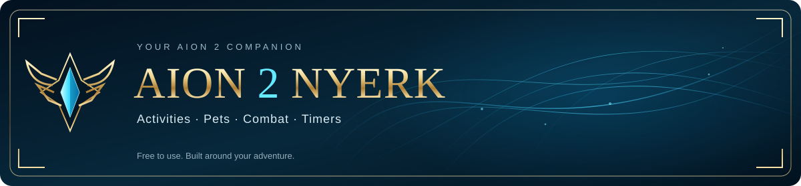
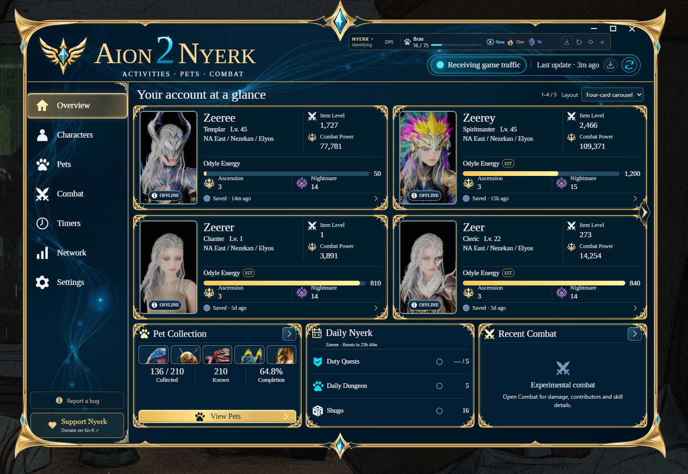

  

  <strong>Your AION 2 adventure, at a glance.</strong> 
  A free Windows companion that brings your characters, pet collection, combat and upcoming activities into one place.

  <a href="https://github.com/Zeerey/aion2-nyerk-releases/releases/tag/v1.0.0-rc.28"><strong>Download for Windows</strong></a>
  &nbsp; · &nbsp;
  <a href="docs/GETTING_STARTED.md">Getting started</a>
  &nbsp; · &nbsp;
  <a href="https://github.com/Zeerey/aion2-nyerk-releases/issues/new/choose">Feedback &amp; requests</a>
  &nbsp; · &nbsp;
  <a href="https://ko-fi.com/zeerey">Support Nyerk</a>

<strong>Windows 10 / 11 · x64 · Free · Actively developed</strong>

*Interface preview from a development build. Check the release notes for the features included in your download.*

## Meet Nyerk

Start Nyerk before logging into AION 2 and let supported game observations fill in the details as you play. Spend less time checking separate screens and more time on your next adventure.

| At a glance | What it brings together |
| --- | --- |
| **Your characters** | Saved characters, levels, item level, combat power, Odyle Energy and tracked activities. Choose a compact roster, cards or a four-card carousel. |
| **Your pets** | Account-wide collection progress, searchable pets and a small popout showing the latest acquired pet's progress. |
| **Your combat** | Experimental damage totals, encounter-average DPS, contributor rankings and skill details. Supported summon damage follows its verified owner. |
| **Your next activity** | Event countdowns, boss tracking tools, favorites and configurable reminders. Server and faction context helps show relevant entries. |
| **Your companion bar** | Choose Pets, Combat and Timers in a movable popout. DPS rows expand as needed, with compact event alerts and quick hover details. |
| **Your feedback** | An in-app bug-report shortcut, diagnostic recording tools and frequent development updates. |

Nyerk fills supported information automatically when it is observed. Values can remain unknown until the relevant game data arrives; saved information and estimates are not the same as a fresh observation. [Explore the features →](docs/FEATURES.md)

## Download

**Recommended public build: [1.0.0-rc.28](https://github.com/Zeerey/aion2-nyerk-releases/releases/tag/v1.0.0-rc.28).** Nyerk is a release candidate in active development, not a final 1.0 release.

**[Download the Windows portable ZIP](https://github.com/Zeerey/aion2-nyerk-releases/releases/download/v1.0.0-rc.28/Aion2Nyerk-1.0.0-rc.28-Portable.zip)** · [Release notes](https://github.com/Zeerey/aion2-nyerk-releases/releases/tag/v1.0.0-rc.28) · [All releases](https://github.com/Zeerey/aion2-nyerk-releases/releases)

1. Install [Npcap](https://npcap.com/#download) for live game tracking. Windows 10/11 x64 and [Microsoft Edge WebView2](https://developer.microsoft.com/en-us/microsoft-edge/webview2) are required.
2. Extract the entire portable ZIP into a folder you can write to.
3. Run **Launch Nyerk.cmd** or **Aion2Nyerk.exe**, then log into AION 2.

Choose the **Portable ZIP** under release assets. GitHub's automatic **Source code** archives contain this downloads repository, not a runnable Nyerk application.

> GitHub's “Latest” badge can point to an older release because newer builds are marked as prereleases. Use the recommended build linked above. RC29–RC31 work is still local and is described separately in the [roadmap](ROADMAP.md).

### Already using Nyerk?

Nyerk checks GitHub at startup and **every hour**. The download icons in the main window and popout glow when a newer compatible release is detected. Open the update panel, download the update, then choose **Install & restart** when you are ready. Manual checks are also available.

Your characters, settings and recordings stay in `%APPDATA%\Aion2Nyerk`. Updates do not require downloading the source project. [Installation and update guide →](docs/GETTING_STARTED.md)

## Built around the way you play

- **Keep the game in view.** Use the popout for pet progress, encounter DPS and upcoming-event alerts.
- **Find what matters.** Switch overview layouts, search the pet collection and pin bosses you care about.
- **Keep track between sessions.** Saved profiles and collection data remain available after restarting.
- **Help shape the next build.** Practical feedback, bug reports and feature requests directly inform ongoing development.

**Useful shortcuts:** `Ctrl + Alt + P` shows or hides the popout. `Ctrl + Alt + L` locks or unlocks it.

## What is still being improved?

Combat decoding is experimental. Missing skill, identity or summon-owner observations can affect totals and names; Nyerk does not claim perfect agreement with other meters. Timers distinguish schedules, estimates and observations. Field-boss respawns depend on kills, so a repeating schedule is not a reliable live boss feed.

The next builds focus on broader combat coverage, saved encounter analysis and game-observed boss deadlines across more maps. [See current limits and the roadmap →](ROADMAP.md)

## Privacy and Windows security

Nyerk reads supported game traffic locally through Npcap; it does not inject into or modify the game. It does not require your AION 2 password. Public downloads contain the application, not developer recordings or user profiles.

The developer submitted an executable to Microsoft. Their review reported **no positive detection or associated telemetry indicators for the submitted file**. That finding applies to the submitted file; it is not Microsoft certification of Nyerk or every future build. Current release candidates are unsigned.

[Privacy, network access and Windows security →](docs/PRIVACY_AND_SAFETY.md)

## Join the development

**[Report a bug](https://github.com/Zeerey/aion2-nyerk-releases/issues/new?template=bug_report.yml)** · **[Request a feature](https://github.com/Zeerey/aion2-nyerk-releases/issues/new?template=feature_request.yml)** · **[Report a timer mismatch](https://github.com/Zeerey/aion2-nyerk-releases/issues/new?template=timer_correction.yml)**

A short explanation of what happened and what you expected is valuable. For combat comparisons, include final damage **and** DPS from the same encounter, when available. Please review screenshots before posting and keep raw packet captures out of public issues.

Nyerk is actively developed, and thoughtful suggestions are welcome. Requests are considered alongside reliability and testing needs; inclusion and timing are not guaranteed.

### Support Nyerk

Nyerk is free to use. If it makes your time in AION 2 easier, you can [support development on Ko-fi](https://ko-fi.com/zeerey). Donations are optional; bug reports and useful feedback help too.

---

[Getting started](docs/GETTING_STARTED.md) · [Features](docs/FEATURES.md) · [Timer guide](docs/TIMERS.md) · [Troubleshooting](docs/TROUBLESHOOTING.md) · [Support](SUPPORT.md) · [Release highlights](CHANGELOG.md)

An independent community project, not affiliated with or endorsed by NCSOFT. AION 2 and related game assets belong to their respective owners. This repository hosts public downloads and documentation; application source is maintained separately.
